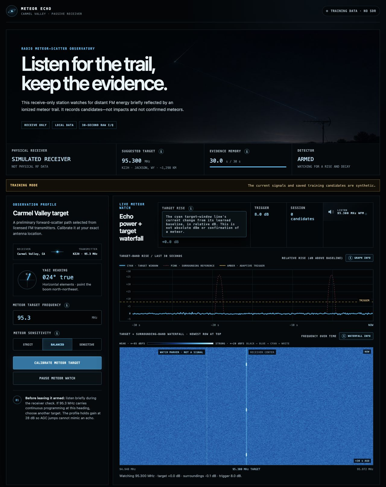
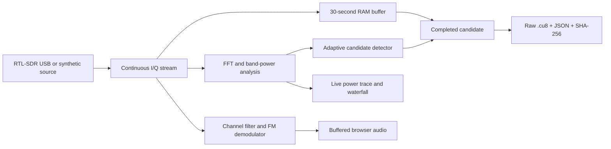

# Meteor Echo Station

### Listen for the trail. Keep the evidence.

A local, receive-only radio observatory that turns RTL-SDR samples into a live
meteor-scatter dashboard: frequency waterfall, echo-power timeline, wide-FM
audio, and integrity-checked raw candidate recordings.

**Python 3.11+ · NumPy · RTL-SDR · Browser Canvas + Web Audio · MIT**

[Try the demo](#try-it-without-radio-hardware) · [How it works](#signal-to-evidence) ·
[Engineering details](#engineering-decisions) · [Field setup](docs/observing-guide.md) ·
[Tests](#validation)



*Actual application screenshot in training mode. The displayed signals are synthetic.*

## The idea

A distant FM broadcast can briefly reflect from the ionized trail left by a
meteoroid. This project watches for those transient changes while preserving the
underlying radio samples for later review.

The application reports **unconfirmed echo candidates**. A single receiver cannot
prove a meteor, reconstruct its trajectory, or locate a meteorite. Aircraft,
interference, and ordinary radio propagation can produce similar signals.

## Try it without radio hardware

The synthetic demo exercises the live dashboard and signal-processing path.
It does not need an SDR, an antenna, cloud credentials, or a remote service.

```bash
git clone https://github.com/alexwastaken/meteor-scatter-sdr.git
cd meteor-scatter-sdr
python3 -m venv .venv
. .venv/bin/activate
python -m pip install -e .
meteor-sdr serve --demo --port 8788
```

Open [localhost:8788](http://127.0.0.1:8788). Let the 30-second evidence buffer
fill, watch the power trace and waterfall, and try the sensitivity controls.
Training data and any saved training candidates stay clearly labeled as synthetic.

For physical capture, install the native RTL-SDR driver, connect the receiver
and antenna, then use `meteor-sdr doctor` and `meteor-sdr serve`.
The [observing guide](docs/observing-guide.md) covers Raspberry Pi installation,
antenna setup, tuning, audio monitoring, and interpreting the displays. The
included Carmel Valley frequency/heading is a field-test starting point, not a
verified meteor channel for every location.

## Signal to evidence



The detector analyzes up to 50 frames per second, while the browser waterfall
updates at up to 12.5 frames per second. Evidence capture, visualization, and
listening share one radio stream.

## Engineering decisions

| Decision | Why it matters | Implementation |
| --- | --- | --- |
| Bounded 30-second I/Q memory | Preserves context without continuously writing raw samples to disk | [Rolling buffer and live monitor](src/meteor_sdr/live.py) |
| Rise-and-decay detection plus surrounding-band comparison | Rejects single-frame spikes and broad interference before saving a candidate | [Candidate detector](src/meteor_sdr/live.py) |
| Fixed receiver gain and an offset tuning center | Reduces gain-change artifacts and keeps the watched channel away from the receiver's DC artifact | [Validated configuration](src/meteor_sdr/config.py) |
| Separate analysis and display rates | Keeps short-event analysis independent of browser rendering | [Live processing](src/meteor_sdr/live.py) |
| Filtered FM audio from the same I/Q stream | Lets the observer listen without retuning or pausing detection | [DSP and audio queues](src/meteor_sdr/live.py), [Web Audio playback](src/meteor_sdr/web/app.js) |
| Raw data plus structured metadata and SHA-256 | Makes each saved candidate inspectable and its file integrity checkable | [Capture](src/meteor_sdr/capture.py), [event archiving](src/meteor_sdr/live.py) |
| Failed-tune rollback and explicit receiver state | Keeps a tuning failure from silently leaving misleading configuration on screen | [Receiver adapter](src/meteor_sdr/rtl.py), [tests](tests/test_live.py) |

At the default 1.024 MS/s, 30 seconds of unsigned 8-bit interleaved I/Q occupies
about **61.4 MB**. Unsaved samples roll out of memory; completed candidate files
remain on disk for deliberate review. Metadata records the receiver, tuning,
antenna profile, duration, signal rise, and integrity hash.

## Validation

```bash
python -m unittest discover -s tests -v
```

The suite contains **48 tests** using synthetic signals, mocked radio hardware,
and local HTTP/TCP endpoints. It covers spectral tone detection, FM channel and
stereo-pilot rejection, candidate rise/decay and interference rejection, raw
archive integrity, retuning rollback, audio buffering, and dashboard routes.

Hardware-free tests do not establish meteor-detection accuracy or sustained
performance on a particular Raspberry Pi. Physical receiver and field-observation
checks remain part of the [observing workflow](docs/observing-guide.md).

## Project map

- [`src/meteor_sdr/rtl.py`](src/meteor_sdr/rtl.py): receiver adapters, tuning, and simulated input.
- [`src/meteor_sdr/live.py`](src/meteor_sdr/live.py): live processing, detector state, evidence buffer, and audio.
- [`src/meteor_sdr/web.py`](src/meteor_sdr/web.py): local HTTP, event-stream, and audio endpoints.
- [`src/meteor_sdr/web/`](src/meteor_sdr/web/): dashboard, Canvas plots, and Web Audio playback.
- [`tests/`](tests/): synthetic-signal, state-transition, and HTTP integration checks.

The dashboard binds to localhost by default and has no authentication. Use a
trusted local network for Pi access; it is not designed as an internet-facing
service. Radio data stays on the computer running the app.

## License

[MIT](LICENSE) · Alex Parsons
